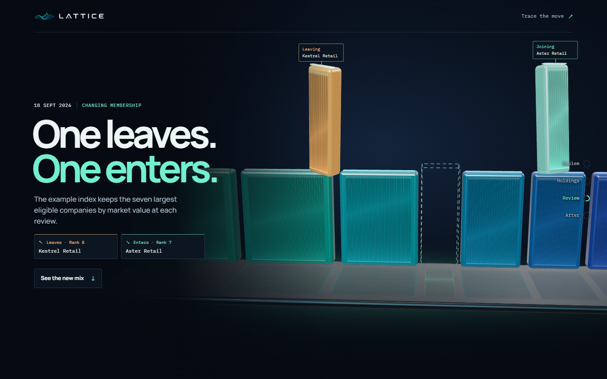

# Lattice

Four interactive design studies explain how equity indexes work through fictional examples for first-time investors in India. [Open the picker](https://acoaria4.github.io/lattice-page/)



| Study | What you can explore |
| --- | --- |
| [V1 · See the bigger picture](https://acoaria4.github.io/lattice-page/v1/) | Follow one tile into a market and compare two ways to weight four companies. |
| [V2 · From one to many](https://acoaria4.github.io/lattice-page/v2/) | Follow the Lattice emblem into an index, then change the weighting rule and Company A’s move. |
| [Trace the Move](https://acoaria4.github.io/lattice-page/study/) | Scroll through a fictional price change and inspect each company’s contribution to the index. |
| [Inside the Index](https://acoaria4.github.io/lattice-page/index-review/) | Open the index into ₹100 of illustrative exposure and scroll across the review when one company replaces another. |

## Run locally

Use Node.js 20.19 or newer on the Node 20 line, or Node.js 22.12 or newer, with pnpm.

```sh
pnpm install --frozen-lockfile
pnpm dev
```

Open the picker at [localhost:5173](http://127.0.0.1:5173/). Run `pnpm build` followed by `pnpm preview` to serve the production build at [localhost:4173](http://127.0.0.1:4173/).

GitHub Pages serves the contents of `dist/` from the root of the `gh-pages` branch. To reproduce the hosted build and test its repository path locally, run:

```sh
pnpm build --base /lattice-page/
pnpm preview --base /lattice-page/
```

Open the [local preview under `/lattice-page/`](http://127.0.0.1:4173/lattice-page/). Vite builds a separate HTML entry for each study, so GitHub Pages can serve deep links directly. Site assets, fonts and JavaScript are bundled locally. The links to SEBI and Nifty Indices provide further reading.

## Motion and artwork

V1 uses Canvas 2D, GSAP ScrollTrigger and Lenis on desktop, with native scrolling on touch devices. V2 and the two later studies use Three.js. In the circular studies, native scroll controls the scene in both directions. Inside the Index carries the replacement company into the next lap, and scrolling backward restores the prior lineup. HTML provides the chapter controls and the linear reading view for reduced motion or unavailable WebGL.

The wordmark, favicon and emblem derive from supplied Lattice artwork. The campaign illustrations and studio environment were generated with ImageGen. V2’s notes document how its live geometry and palette were derived from the emblem. [V2 design notes](v2/README.md)

The shifts in scale, from one company to a wider market, draw on the camera and composition of the original design reference. [Pioneer Corn Revolutionized](https://cornrevolution.resn.global/)
